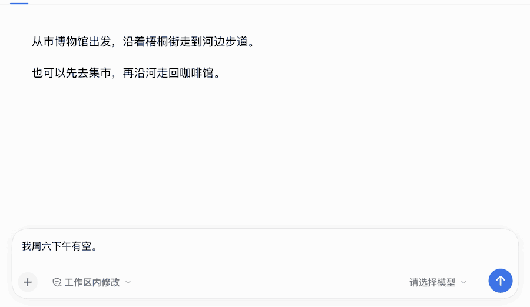

# Quote & Reply for DeepSeek Harness

[](https://github.com/hiyced/dsh-quote-reply/releases/latest)
[](https://github.com/awesome-dsh-plugin/awesome-dsh-plugin/blob/main/data/plugins/hiyced__dsh-quote-reply.yml)
[](LICENSE)

[简体中文](README.zh.md)

**Select text and reply right beside it.** Each quote reply appears as a removable chip at the top of the composer.



## Features

- **Reply in place.** Open a popover from the text selection. The preview shows up to three lines. Hover or click to see the full quote.
- **Answer several passages together.** Click **+ Select another**, highlight another passage, and click **Add quote**. Your reply stays in the popover.
- **Keep quote replies in view.** Chips stay above the draft text as you type or scroll, in the order you added them. Hover to read a reply in full or click `×` to remove it.
- **Send from the composer.** At send time, the quoted text becomes standard Markdown blockquotes, with a blank line before the reply. The UI follows the Harness language setting and supports English and Simplified Chinese.


## Install

Requires DeepSeek Harness `0.2.2-rc.5` or a compatible newer `0.2.x` version. Verified in the `0.2.2-rc.5` Web UI.

In DSH NEXT, open **Plugins → Plugin Market** and search for `dsh-quote-reply`. Choose the entry by **`hiyced`** under **Sessions & Messages**.

<details>
<summary>Install from a local clone</summary>

```sh
git clone https://github.com/hiyced/dsh-quote-reply.git
cd dsh-quote-reply
```

For desktop, launch Harness once to initialize it, then quit the app. Run the command from the repository directory and reopen the app.

```sh
dsh plugin --profile desktop add "link:$PWD"
```

On macOS, you can also use the CLI bundled with the app.

```sh
"/Applications/DeepSeek Harness.app/Contents/Resources/runtime/cli/bin/dsh" plugin --profile desktop add "link:$PWD"
```

For Web, run the following commands and open the address printed in the terminal.

```sh
dsh plugin --profile web add "link:$PWD"
dsh web
```

</details>

## Usage

1. Select text in a conversation and click **Quote reply** beside the selection.
2. Write your reply. Press `Enter` or click the blue up arrow to add it to your draft.
3. To write a separate reply, select the next passage and click **Quote reply** to open a fresh popover. The two chips are shown in order at the top of the composer and can be sent together.

In the popover, press `Shift+Enter` for a new line. Press `Esc`, click **Esc Cancel**, or click outside the popover to close it. **Add to draft** is disabled while the reply is empty.
