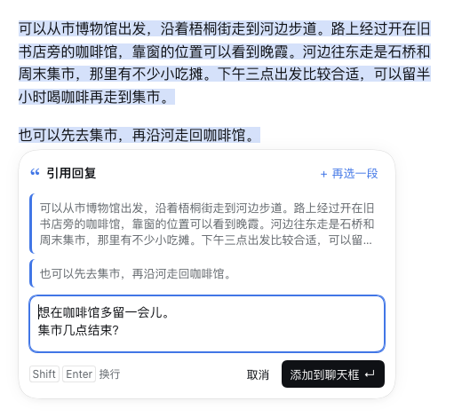
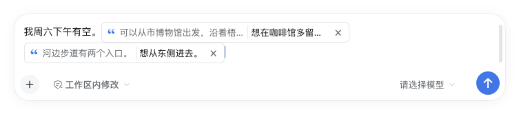

# 引用气泡回复

这是一个 DeepSeek Harness 插件。划选会话中的文字后，可以直接在选区旁回复。同一条回复可以引用多段原文，加入聊天框后会收成一个气泡。

## 安装

已在 DeepSeek Harness `0.2.2-rc.5` 的 Web 界面验证。请使用与应用版本配套的 `dsh` 命令。

### 桌面端

1. 打开一次 DeepSeek Harness，让应用完成首次初始化，然后彻底退出。
2. 在本仓库根目录运行以下命令。

   ```sh
   dsh plugin --profile desktop add "link:$PWD"
   ```

   macOS 上也可以用应用自带的命令行。

   ```sh
   "/Applications/DeepSeek Harness.app/Contents/Resources/runtime/cli/bin/dsh" plugin --profile desktop add "link:$PWD"
   ```

3. 重新打开 DeepSeek Harness，在「插件」页查看「引用气泡回复」。

### Web 端

在本仓库根目录执行以下命令，再打开终端打印的网址。

```sh
dsh plugin --profile web add "link:$PWD"
dsh web
```

插件启用后，由「引用回复」接管划选文字时的引用操作。

## 使用说明

1. 在会话消息里划选文字，点击选区旁的「引用回复」。
2. 气泡会显示最多三行原文。悬停可以查看全文，也可以点击预览展开。
3. 点击「再选一段」可以继续划选，点「加入引用」把新选区放进同一条回复。
4. 输入回复后按 `Enter` 或点击「添加到聊天框」。内容会先进入草稿，再由聊天框的发送按钮提交。
5. 在聊天框里悬停气泡可查看全文，点击「×」可删除这一条引用和回复。

| 操作 | 效果 |
| --- | --- |
| `Enter` | 把有内容的回复加入聊天框草稿 |
| `Shift+Enter` | 在回复中换行 |
| `Esc`、点击「取消」或点击气泡外 | 关闭气泡 |
| 回复为空或只有空白字符 | 「添加到聊天框」按钮禁用 |

发送时，原文每一行会加上 `>`，引用和回复之间空一行。

## 实现效果

### 在同一条回复中引用两段原文



### 聊天框中的可删除气泡



截图来自隔离的 Harness 实例，使用的是示例会话。
